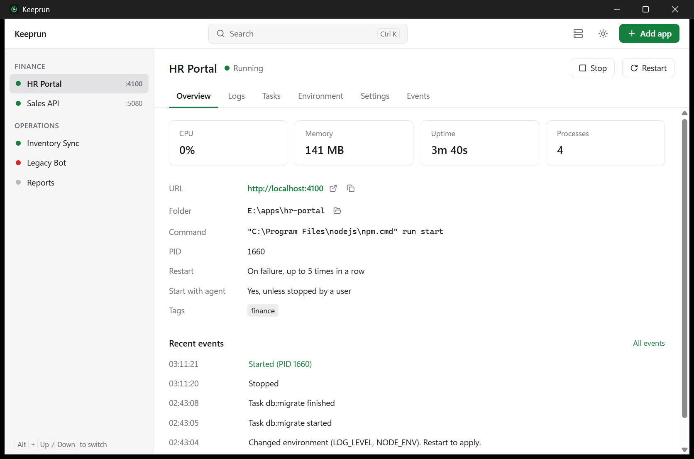
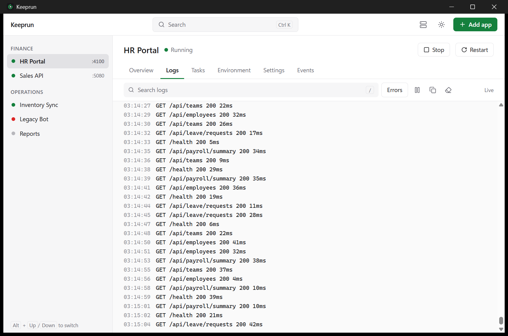

<div align="center">


# Keeprun

**Keep internal apps running on Windows Server.**

Point Keeprun at a folder. It detects Node, .NET or Python, runs the app under a Windows service,
restarts it when it crashes and brings it back after a reboot.

[Website](https://keeprun.app) &nbsp;&middot;&nbsp; [Download](https://github.com/yobotn/keeprun/releases/latest) &nbsp;&middot;&nbsp; [Getting started](docs/getting-started.md) &nbsp;&middot;&nbsp; [Deploy at scale](docs/deployment.md) &nbsp;&middot;&nbsp; [CLI](docs/cli.md)

[](https://github.com/yobotn/keeprun/releases/latest)
[](https://github.com/yobotn/keeprun/actions/workflows/ci.yml)
[](LICENSE)


<br>

<picture>
  <source media="(prefers-color-scheme: dark)" srcset="docs/assets/screenshot-dark.png">
  
</picture>

</div>

## Why

Internal apps on Windows usually run as a `.bat` in a Startup folder, a Scheduled Task, or a
service wrapper someone set up years ago. A crash goes unnoticed until users call. Logs live in a
console window nobody sees. Connection strings sit in plain text.

Keeprun replaces that with **one Windows service** that supervises every app on the server, a
**desktop app** to see and control them, and a **CLI** for scripts and remote sessions. No Docker,
no WSL, no cloud.

## Features

<table>
<tr>
<td width="50%" valign="top">
&nbsp;<b>Detects how to run it</b><br>
npm, pnpm, yarn and bun scripts, .NET projects and published builds, Python with venv, uvicorn,
Flask and Django. Or any command line.
</td>
<td width="50%" valign="top">
&nbsp;<b>Restarts on crash</b><br>
Backoff from 1 second up to 60. After repeated crashes the app is marked Failed instead of
looping forever.
</td>
</tr>
<tr>
<td valign="top">
&nbsp;<b>Survives reboots</b><br>
Apps that were running start with the server. Apps you stopped stay stopped.
</td>
<td valign="top">
&nbsp;<b>Ends the whole process tree</b><br>
Each app runs in a Windows Job Object. Stop ends every child process, so the port is free for
the next start.
</td>
</tr>
<tr>
<td valign="top">
&nbsp;<b>Logs and events</b><br>
Live output with search, rotated by size, plus a history of starts, stops, crashes and changes.
</td>
<td valign="top">
&nbsp;<b>Health at a glance</b><br>
CPU, memory, process count, uptime and the TCP ports each app actually listens on.
</td>
</tr>
<tr>
<td valign="top">
&nbsp;<b>Ports without surprises</b><br>
One port per app. Keeprun refuses duplicates and names the process holding a busy port.
</td>
<td valign="top">
&nbsp;<b>Tasks on demand</b><br>
Migrations, seeds and installs are saved as tasks and run when you choose, with the app's
environment.
</td>
</tr>
<tr>
<td valign="top">
&nbsp;<b>Encrypted secrets</b><br>
Secret environment values are stored with Windows DPAPI and masked in the UI. Import a
<code>.env</code> and keys like <code>PASSWORD</code> and <code>TOKEN</code> are marked secret.
</td>
<td valign="top">
&nbsp;<b>Built for IT</b><br>
Silent MSI for Intune and SCCM, repair and in-place upgrades, signed updates you can turn off
with Group Policy.
</td>
</tr>
</table>

<picture>
  <source media="(prefers-color-scheme: dark)" srcset="docs/assets/logs-dark.png">
  
</picture>

## Install

Download the MSI or setup.exe from the [latest release](https://github.com/yobotn/keeprun/releases/latest)
or [keeprun.app](https://keeprun.app), then run it as Administrator. It installs:

- **Keeprun Agent**, a Windows service that starts with the server
- **Keeprun**, the desktop app
- **`keeprun`**, the CLI, added to PATH

Then open Keeprun, press **Add app** (`Ctrl+N`), pick the app folder and choose **Save and start**.

### From a terminal

```powershell
keeprun add --cwd D:\apps\hr-portal --port 4100 --start   # detect, add, start
keeprun list                                              # status, CPU, memory, ports
keeprun logs hr-portal -f                                 # follow the logs
keeprun run hr-portal db:migrate                          # run a saved task
```

### On a fleet

```powershell
msiexec /i Keeprun_<version>_x64_en-US.msi /qn KEEPRUN_PORT=7171 KEEPRUN_DISABLE_UPDATES=1
```

| MSI property | Effect |
|---|---|
| `KEEPRUN_PORT` | Agent API port, default 7171 |
| `KEEPRUN_USER` | User who may use the desktop app and CLI |
| `KEEPRUN_DISABLE_UPDATES=1` | No update checks |
| `KEEPRUN_UPDATE_URL` | Internal update mirror |

Details in the [deployment guide](docs/deployment.md).

## Compared with the usual setup

| | Keeprun | Service wrapper per app (NSSM, WinSW) | Task Scheduler |
|---|:---:|:---:|:---:|
| One service for every app on the server | Yes | No, one service per app | No |
| Detects how to run Node, .NET and Python apps | Yes | No | No |
| Live logs and health for all apps in one UI | Yes | No | No |
| Secret environment values encrypted at rest | Yes | No | No |
| Restart with backoff, then stop retrying | Yes | Configurable | Limited |

## Security

&nbsp;The API listens on `127.0.0.1` only and requires a token that only SYSTEM, Administrators and
the **Keeprun Users** group can read. Secrets are encrypted with DPAPI. There is no telemetry and
no account. Updates are signed, need administrator approval, and can be turned off by policy.
Read the [security model](docs/security.md).

## Documentation

| | |
|---|---|
| [Getting started](docs/getting-started.md) | Install and add your first app |
| [Deployment](docs/deployment.md) | Silent install, upgrades, repair, access, updates, signing |
| [Configuration](docs/configuration.md) | Settings, dev and prod environments |
| [CLI](docs/cli.md) | Every command, tasks, JSON output |
| [Agent API](docs/api.md) | Local HTTP and WebSocket API |
| [Security](docs/security.md) | Threat model and design choices |
| [Troubleshooting](docs/troubleshooting.md) | Common problems and fixes |
| [Releasing](docs/releasing.md) | Versioning, signing keys, website |

## Development

Keeprun is a Rust workspace with a Tauri 2 and Svelte 5 desktop app.

```
crates/core      Settings, API types, stack detector, token
crates/agent     keeprun-agent: Windows service, supervisor, SQLite, HTTP and WebSocket API
crates/cli       keeprun: command line client
apps/desktop     Desktop app and installer configuration
site/            Website (keeprun.app), built with docs/ into GitHub Pages
```

You need Windows 10 or later, Rust stable (MSVC), Node.js 20 or later and WebView2.

```powershell
npm run setup    # UI dependencies
npm run dev      # dev agent on 127.0.0.1:7181 and the desktop app with hot reload
npm test         # Rust tests
npm run lint     # clippy, rustfmt, text lint, svelte-check
npm run build    # release binaries, MSI and setup.exe
```

Dev and prod use separate ports, data folders and service names, so a dev build never touches
an installed Keeprun. See [configuration](docs/configuration.md).

## License

[Apache 2.0](LICENSE). Icons from [Lucide](https://lucide.dev) (ISC).
